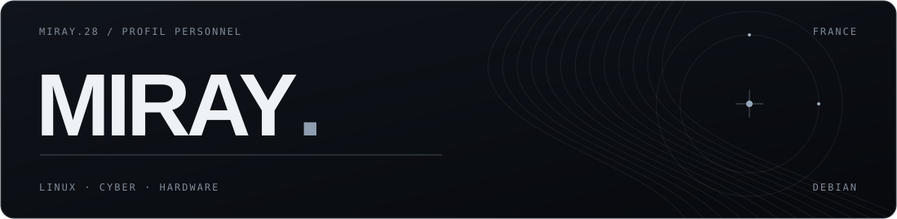

  

<strong>Cybersécurité · Linux · Réparation de téléphones</strong>

  <a href="https://miray-28.github.io/">Mon site</a> &nbsp; / &nbsp;
  <a href="https://tryhackme.com/p/Miray.28">TryHackMe</a> &nbsp; / &nbsp;
  <a href="https://discord.com/users/1446790294472232990">Discord</a> &nbsp; / &nbsp;
  <a href="https://guns.lol/miray.28">guns.lol</a> &nbsp; / &nbsp;
  <a href="https://www.tiktok.com/@miray.280">TikTok</a>

---

### `whoami`

Moi, c’est **miray**. 17 ans, en France.

Je pratique la cybersécurité sur TryHackMe et je fais des CTF. Je maîtrise Linux et j’utilise **Debian** au quotidien. À côté, je répare des téléphones : **écrans et batteries**.

| Profil | |
| :--- | :--- |
| Système | Debian / Linux |
| Plateforme | [TryHackMe — Miray.28](https://tryhackme.com/p/Miray.28) |
| Discord | [miray.28.](https://discord.com/users/1446790294472232990) |
| Portfolio | [miray-28.github.io](https://miray-28.github.io/) |

### `~/skills`

  

### `~/tools`

  

### `~/hardware`

  

### Réparation de téléphones

- Changement d’écran.
- Remplacement de batterie.

### Mon parcours

- **CTF & labs** — [Mon profil TryHackMe](https://tryhackme.com/p/Miray.28).
- **Cyber, outils & matériel** — [Mon portfolio](https://miray-28.github.io/).
- **Mon site personnel** — [Le dépôt GitHub](https://github.com/Miray-28/miray-28.github.io).

---

<a href="https://miray-28.github.io/"><strong>miray-28.github.io ↗</strong></a>

